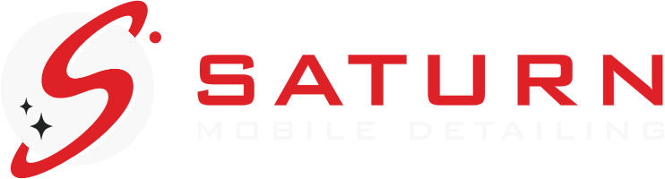

# Saturn Mobile Detailing — Brand Kit

Single source of truth for the Saturn Mobile Detailing logo, colors and web assets.
**If you are an AI assistant working on this website: read this file first, use the assets here, and do not redraw, recolor or retype the logo.**

## Quick start (website scaffold)

1. Copy this folder into the site repo as `/brand` (or `public/brand`).
2. In your HTML `<head>`:

```html
<link rel="stylesheet" href="/brand/tokens/tokens.css">
<link rel="icon" href="/brand/web/favicon.ico" sizes="48x48">
<link rel="icon" href="/brand/web/favicon.svg" type="image/svg+xml">
<link rel="apple-touch-icon" href="/brand/web/apple-touch-icon.png">
<meta name="theme-color" content="#212222">
```

3. Header logo (default dark theme):

```html
<a href="/"></a>
```

4. Style with the semantic variables, never raw hex:

```css
body   { background: var(--bg); color: var(--fg); font-family: var(--font-body); }
.btn   { background: var(--accent); color: var(--on-accent); border-radius: var(--radius); }
.btn:hover { background: var(--accent-hover); }
```

## Colors (from `source/saturn_detailing.pdf`)

| Name | Hex | RGB | CMYK | Pantone |
|---|---|---|---|---|
| Saturn Red | `#DE2027` | 222, 32, 39 | 8, 100, 100, 0 | 7621 C |
| Saturn White | `#F8F8F9` | 248, 248, 249 | 0, 0, 0, 2 | P 179-1 C |
| Saturn Charcoal | `#212222` | 33, 34, 34 | 73, 65, 65, 72 | — (process) |

Machine-readable: `tokens/tokens.json`. CSS: `tokens/tokens.css`.
(The charcoal swatch in the PDF carries a leftover name, "C=89 M=41 Y=100 K=72 1 copy"; its actual values are the ones above.)

## Themes

Dark is the primary design. Switch with `<html data-theme="light">` or `"red"`. Always use the logo set that matches the background:

| Theme | Background | Logo folder | Accent |
|---|---|---|---|
| `dark` (default) | Charcoal | `logos/dark/` | Red |
| `light` | White | `logos/light/` | Red |
| `red` | Red | `logos/red/` | Charcoal |

## Logo assets

Pattern: `logos/<theme>/svg/<asset>.svg` and `logos/<theme>/png/<asset>-<1024|4096>.png`. All are transparent and tightly cropped.

| Asset | Use for |
|---|---|
| `lockup-horizontal` | Site header / nav, email signature, wide banners |
| `lockup-stacked` | Hero, footer, social profile, square-ish spaces |
| `mark` | Primary icon (planet + S) — avatars, small spaces, loaders |
| `wordmark` | "SATURN / MOBILE DETAILING" text only, when the icon is already shown nearby |
| `icon-1`, `icon-2`, `icon-3` | Alternate icon treatments of the mark (outline, solid, etc.) for style experiments — see `logos/<theme>/png/` |

Format guidance: **use SVG on the web** (sharp at any size). Use the `-4096.png` for print, vendors, slide decks, or anything that can't take SVG; `-1024.png` for general raster use. Never upscale the 1024 PNGs.

Web icons in `web/`: `favicon.ico`, `favicon.svg`, `favicon-16/32/48.png`, `apple-touch-icon.png` (180), `icon-192.png`, `icon-512.png` (opaque charcoal background, mark inside the maskable safe zone).

## Logo rules

- Don't recolor, stretch, rotate, add effects to, or re-create the logo. Swap to another colorway folder instead.
- The wordmark is Bank Gothic BT Medium, already converted to outlines. Never retype it with a web font.
- Give the logo breathing room — roughly a quarter of the mark's height on every side is a sensible minimum (guideline, not from the PDF).
- Keep the mark readable: avoid going below ~24px tall for `mark`, ~28px tall for lockups.
- The red-colorway wordmark uses pure white (`#FFFFFF`) exactly as designed in the PDF; everything else uses the three brand colors.
- Dark-colorway logos contain charcoal "shadow" shapes baked in by design; they are meant for charcoal backgrounds. Use the `light` or `red` set on other backgrounds.

## Type

Not specified in the brand file beyond the logo wordmark. `tokens.css` suggests Michroma/Orbitron (display) and Inter (body) as placeholders; change `--font-display` / `--font-body` to experiment.

## Experimenting with styles

Work in `variants/<name>/` (see `variants/README.md`). Override only the semantic tokens (`--bg`, `--fg`, `--accent`, fonts, radius); leave the three brand colors and the logo files alone.

## For AI assistants: add to the site repo's `CLAUDE.md` / `AGENTS.md`

```
Brand: Saturn Mobile Detailing. Before any UI work, read /brand/BRAND.md.
Use /brand/tokens/tokens.css variables (no raw hex), logos from /brand/logos/<theme>/, never redraw or recolor the logo.
```

## Source files

- `source/saturn_detailing.pdf` — original vector master from Illustrator (3 colorways + swatches). Anything not covered here can be re-extracted from it.
- `source/saturn_detailing_full-sheet.svg` — the same sheet converted to SVG (colors are approximate; the exported logo SVGs use the exact brand hex values).
